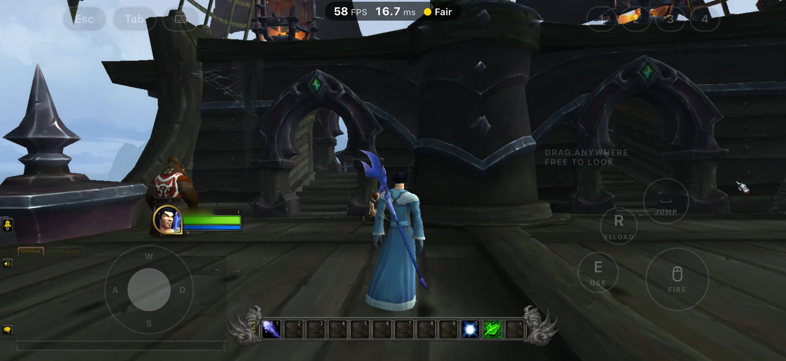
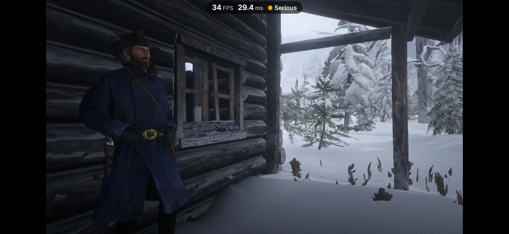
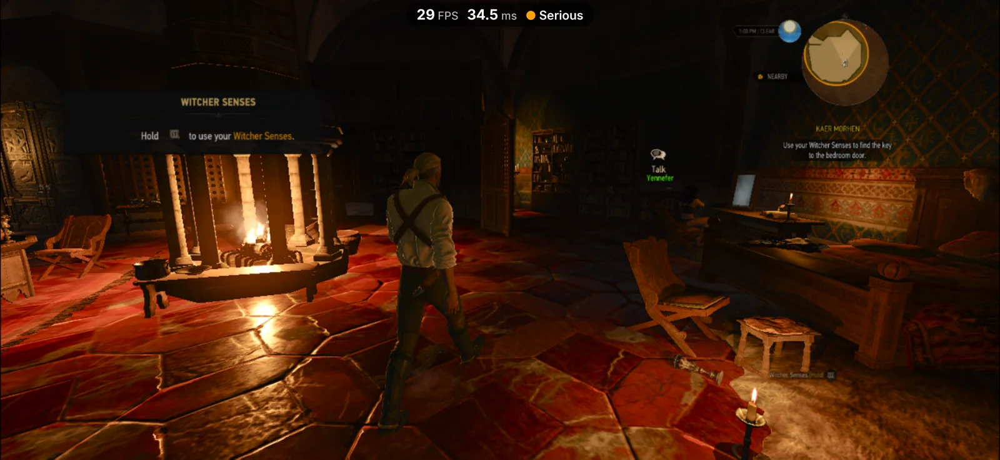
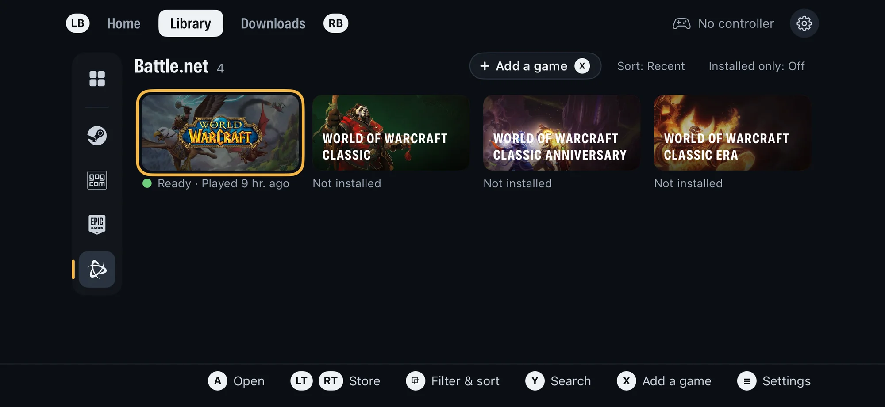
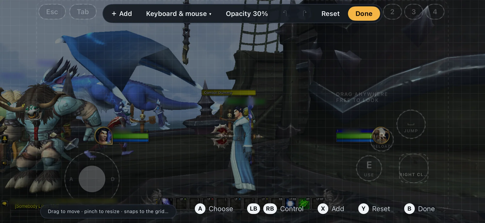
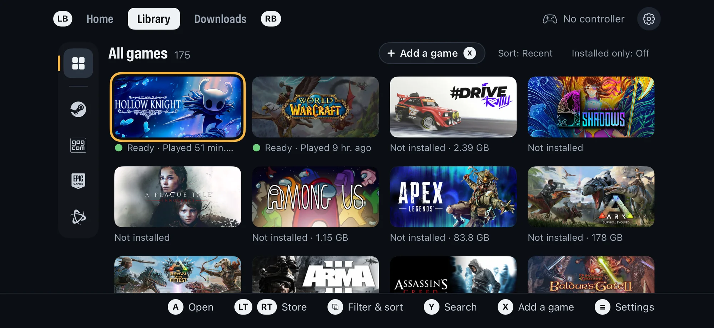
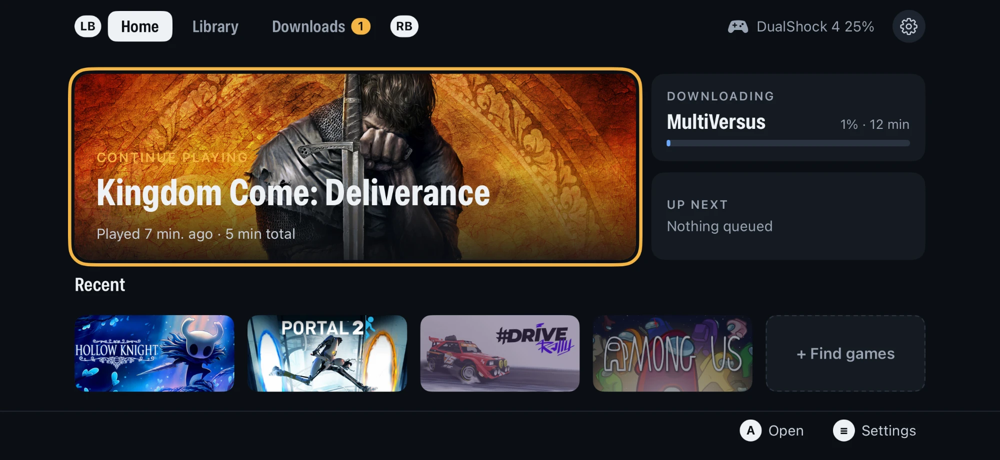
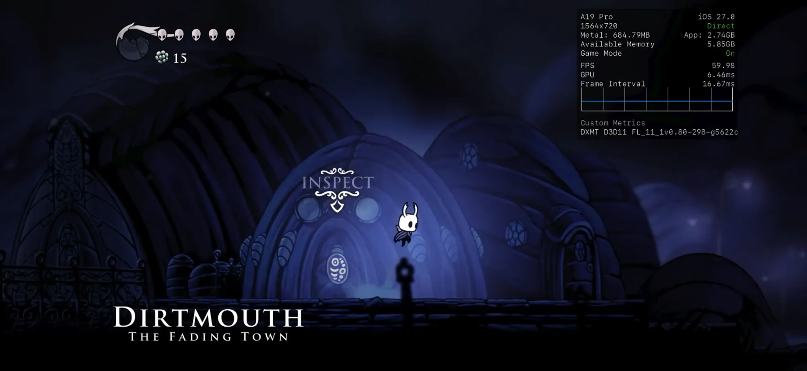
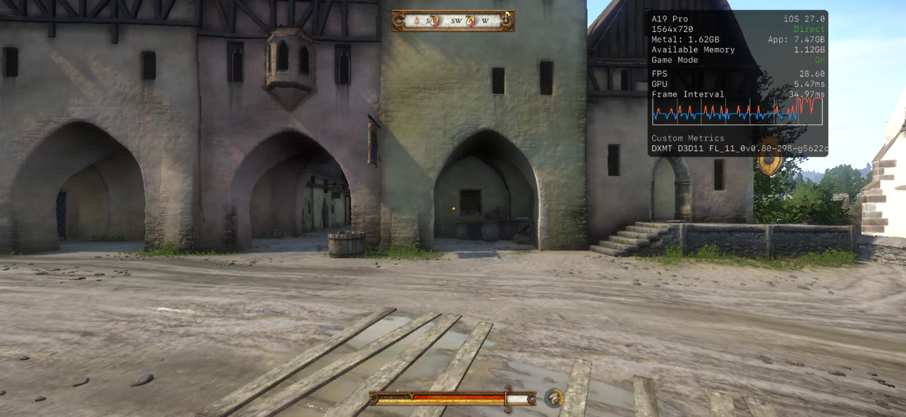
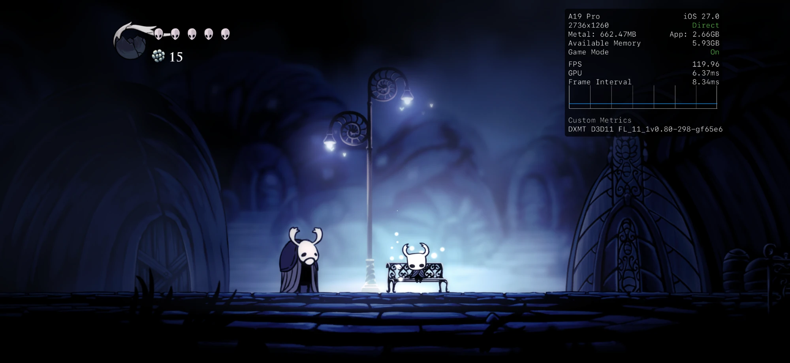

# Playport

**PC games on your iPhone. Natively, no streaming.**

[Website](https://playport.dev/) · [Download](https://github.com/playportdev/playport/releases) · [Game compatibility](https://playport.dev/compatibility/) · [Architecture](docs/ARCHITECTURE.md) · [❤️ Support on Ko-fi](https://ko-fi.com/playportdev)

Playport runs Windows games, 64-bit and 32-bit, on a stock, non-jailbroken
iPhone. Install a game from Steam, GOG, Epic Games or Battle.net, or bring your
own, pick up a controller or play with on-screen touch controls, and press Play.
The game runs on the phone's own CPU and GPU: no PC, no cloud, no stream.

> **New in 0.5: World of Warcraft, Red Dead Redemption 2, The Witcher 3: Wild Hunt
> – Remastered and touch controls.** Install World of Warcraft from Battle.net,
> play with nothing but the phone using on-screen controls and their layout editor,
> and find every store in the redesigned Library. See the
> [release notes](https://playport.dev/releases/#v0.5.0).

> [!TIP]
> **❤️ Playport is free, and it stays free. If it put a PC game in your pocket,
> please consider [supporting it on Ko-fi](https://ko-fi.com/playportdev).**
> Every donation buys time for the next release: more games and more fixes.
> See [Support Playport](#support-playport).

  
   <b>World of Warcraft</b> from Battle.net, played with Playport's on-screen keyboard and mouse controls.

<table>
  <tr>
    <td width="50%"></td>
    <td width="50%"></td>
  </tr>
  <tr>
    <td align="center"><b>Red Dead Redemption 2</b>: Story mode, signed in through Rockstar's own launcher (new in 0.5)</td>
    <td align="center"><b>The Witcher 3: Wild Hunt – Remastered</b>: the current version, in Kaer Morhen (new in 0.5)</td>
  </tr>
</table>

<table>
  <tr>
    <td width="50%"></td>
    <td width="50%"></td>
  </tr>
  <tr>
    <td align="center"><b>Battle.net</b>: World of Warcraft and its Classic editions in the same Library (new in 0.5)</td>
    <td align="center"><b>Layout editor</b>: move, resize and add touch buttons (new in 0.5)</td>
  </tr>
</table>

<table>
  <tr>
    <td width="50%"></td>
    <td width="50%"></td>
  </tr>
  <tr>
    <td align="center"><b>Library</b>: everything you own on Steam, GOG, Epic Games and Battle.net, installed or not</td>
    <td align="center"><b>Home</b>: pick up where you left off</td>
  </tr>
</table>

  
   <b>Watch the uncut recording</b>: Library to Play to Hollow Knight at 60 fps, then Quit back to Home (<a href="site/video/hollow-knight.mp4">MP4</a>).

<table>
  <tr>
    <td width="50%"></td>
    <td width="50%"></td>
  </tr>
  <tr>
    <td align="center"><b>Kingdom Come: Deliverance</b>: Rattay through DXMT's Direct3D 11, about 29 fps at 720 rows</td>
    <td align="center"><b>Hollow Knight</b>: the full 2736×1260, up to 120 fps</td>
  </tr>
</table>

On an A19 Pro iPhone, iOS 27.0.

## Features

- **Steam, GOG and Epic Games.** Sign in to any of them in Settings › Accounts;
  your Windows games from each show up in one Library with the store's artwork.
  Install, Update, Verify and Repair go through one Downloads queue onto the
  phone. Steam brings cloud saves and achievements. *New in 0.4: GOG and Epic.*
- **Add a game from Files.** A DRM-free game's folder or `.zip` joins the
  Library under Local. Installers are not run. *New in 0.4.*
- **Games sign in to their store.** A game gets what its store's launcher would
  give it: Epic's sign-in, Steam's app and session tickets, GOG Galaxy's sign-in.
  A sign-in page a game opens shows in a panel over the play. *New in 0.4.*
- **32-bit and 64-bit games.** Each 32-bit game gets its own 4 GB window above the
  memory iOS keeps for itself; Portal 2 plays at about 60 fps at 720p.
- **Native on the phone.** Wine, the FEX x86 translator and the graphics
  backends run inside one iOS app, rendering through Metal.
- **Vulkan through KosmicKrisp**, every game's default: Direct3D 8 to 11 through
  DXVK, Direct3D 12 through vkd3d-proton and OpenGL through Zink. DXMT stays one
  choice away for Direct3D 10 and 11.
- **Made for a controller.** A landscape, gamepad-first app with an in-game menu
  to pause, resume or quit; controllers reach the game as XInput.
- **JIT your way.** A built-in JIT helper after a one-time pairing, or JIT from
  StikDebug or LiveContainer.
- **Help when a game fails.** A game page's Report a problem shares one zip of
  its logs, and the [compatibility list](https://playport.dev/compatibility/)
  shows what runs.

**More than a repackage.** Over 200 of our own [patches](patches/) on Wine,
FEX, DXMT, KosmicKrisp, vkd3d-proton, DXVK and the Steam API emulator: the
32-bit runtime, performance work (faster FEX translation for Unity games, x87
math at native precision, lossless texture compression kept on in DXMT and
KosmicKrisp, geometry shaders in KosmicKrisp), dozens of bug fixes, and the
diagnostics behind them. Each one is a reviewable patch with the evidence for it.

## Install

Playport is not on the App Store: you sideload the `.ipa` yourself, with your
own Apple ID (a free one works).

1. Download the `.ipa` from [Releases](https://github.com/playportdev/playport/releases).
   It is signed ad hoc (no certificate) and asks for Increased Memory Limit;
   your sideloader signs it for your iPhone.
2. Sideload it with a tool that keeps Increased Memory Limit (below). If the
   tool asks whether to keep app extensions, keep them: Playport's JIT helper
   is one.
3. Turn on Developer Mode (Settings › Privacy & Security), and install
   LocalDevVPN from the App Store for JIT.
4. Open Playport and follow its first-run checklist: pairing, LocalDevVPN,
   Memory and Accounts. Memory has a green tick when the signature kept Increased
   Memory Limit.

Already enable JIT with StikDebug, or run apps in LiveContainer? Settings ›
Setup check › JIT method (or X on the checklist's first step) takes JIT from
StikDebug or from another app instead, with StikDebug's `universal.js` script.
Inside LiveContainer, launch Playport with JIT from LiveContainer.

A free Apple ID signs the app for seven days, so re-sign it once a week; your
games and saves stay on the phone.

### Why pairing, JIT and LocalDevVPN

Playport translates a game's x86 code to ARM while it runs, which needs JIT,
and iOS allows JIT only in an app a debugger has attached to. Pairing makes
Playport's built-in JIT helper that debugger: on iOS 27 you pair once, with a code
in Settings › Privacy & Security › Developer Mode, and LocalDevVPN carries the
connection on the phone itself, so no computer is involved after the install.
On iOS 26, import a pairing file in Settings › Setup check instead.

### Do I need a computer?

To install, yes, once: every sideloader that signs with a free Apple ID starts
from a computer. After that it depends on the tool. SideStore re-signs on the
phone every week, AltStore re-signs through AltServer on your computer, and
Impactor, Sideloadly and Xcode re-install from the computer. Playport itself,
pairing included, then needs no computer.

### Your first game

The checklist's Accounts step signs in to Steam, GOG or Epic Games (more
accounts are in Settings › Accounts, and **Add a game** takes a DRM-free game's folder or `.zip`
from Files). Pick a game in the library, **Install** it (it downloads to the
phone), then **Play**. Connect a
controller before you press Play, and keep Playport in front while the game
starts. A game page's **Report a problem** shares its log when something goes
wrong ([below](#reporting-a-problem)).

### Which sideloaders keep the memory limit

iOS closes an app that uses more memory than its limit, and Playport's JIT
memory, the runtime and the game all share that one limit. With Increased
Memory Limit our 12 GB test iPhone gives Playport 6 to 8 GB; without it an
8 GB iPhone gives about 3.3 GB, and Playport will not start a game known to
need more. The `.ipa` asks for it, but iOS grants it only when the sideloader
also turns the capability on for the app's App ID at Apple, and not every
sideloader does.

| Sideloader | Keeps Increased Memory Limit |
| --- | --- |
| AltStore Classic 2.2 or later | yes |
| [Impactor](https://github.com/khcrysalis/PlumeImpactor), from a computer | yes |
| Xcode with a Personal Team | yes |
| SideStore 0.7.0, free Apple ID | **no**: do the [one-time fix below](#sidestore-when-memory-has-no-tick) |
| Sideloadly and others | check the Memory step |

Whatever you use, Playport tells you: the first-run checklist's **Memory**
step has a green tick, and Settings › Setup check shows Increased Memory Limit
On. If it is Off, the step's **How to fix** shows what to do; **Not now** puts
it off, and smaller games still play.

### SideStore: when Memory has no tick

SideStore asks for Increased Memory Limit but does not turn it on for a free
Apple ID ([SideStore#1616](https://github.com/SideStore/SideStore/issues/1616)),
so Playport's App ID gets it once with GetMoreRam:

1. Install Playport with SideStore as usual, so its App ID exists.
2. Sideload [GetMoreRam](https://github.com/hugeBlack/GetMoreRam) and, in its
   Settings, sign in with the same Apple ID SideStore uses.
3. On its **App IDs** page tap **Refresh**, tap Playport's App ID, then **Add
   Increased Memory Limit**.
4. Reinstall Playport from SideStore. It upgrades in place: your games and
   saves stay.
5. Open Playport: the Memory step has its tick, and Settings › Setup check
   shows Increased Memory Limit On.

The capability stays on the App ID, so SideStore's weekly refresh keeps it. If
the tick ever goes away, repeat steps 3 and 4. GetMoreRam takes one of a free
Apple ID's three app slots; delete it afterwards to free the slot.

## Support Playport

Playport is free and open source. Getting World of Warcraft, Red Dead
Redemption 2 or The Witcher 3 running on a phone takes a lot of work, game by
game. If Playport is worth something to you, please consider a donation: it is
what keeps new releases coming.

  

A donation is a gift: it buys no licence, no extra rights and no different build,
and everyone may keep sharing Playport under its licence.

## Game compatibility

Which games run, and how well: the [compatibility list](https://playport.dev/compatibility/)
has every game we have played and every one players have reported, with its status,
searchable and filtered by first letter or status (its data is
[`site/compatibility/games.json`](site/compatibility/games.json)). Played a game,
working or not? [Report it](https://github.com/playportdev/playport/issues/new?template=problem.yml)
and it goes on the list.

## Reporting a problem

Open a [GitHub issue](https://github.com/playportdev/playport/issues/new/choose)
and attach the log; that is the one place we read them all. On the game's page,
**Report a problem** shares the logs as one `.zip`: save it to Files, then drag it
into the issue (GitHub takes files up to 25 MB, so it fits where Pastebin does
not). Before 0.4.0 it shares the bare log: long-press it in Files and choose
**Compress** first. The form asks for your
device, iOS and Playport versions, sideloader and JIT method.

## Release status and support

This is a development project, not a supported general-purpose Windows
compatibility layer or an approved public IPA distribution route. Hollow Knight
is the reference phone-test title; [`AGENTS.md`](AGENTS.md) and
[`docs/evidence/`](docs/evidence/) describe the checks. Games, Steam accounts and
pairing material are not supplied. Support is best-effort: redact account,
device, pairing and session data before sharing logs.

Public CI checks source and host tests only; it does not build, sign, install,
test on a phone or upload IPAs. A green check is not release approval. The
recipient source-bundle build and public signing workflow remain untested;
[DISTRIBUTION.md](docs/DISTRIBUTION.md) is the release procedure.
The Linux pipeline uses Apple's SDK and ld64: a working build or Personal Team
signature does not settle Apple's SDK, provisioning, JIT or delivery terms.

## Good to know

- Playport is early and is tested on one phone: an A19 Pro iPhone (iPhone18,4) on iOS 27.0
  ([known-good versions](docs/DEVICE.md#known-good-ios-versions)).
- 32-bit games are newer than 64-bit ones, so expect rough edges.
- A free Apple ID signs apps for seven days, so refresh the app once a week
  (SideStore can do it on the phone, after the one-time
  [memory step](#sidestore-when-memory-has-no-tick)). Your games and saves stay on the phone.
  Playport takes one of the free account's three app slots; its JIT helper takes
  no slot but is one of the ten App IDs the account may register a week.
- How it works: [architecture](docs/ARCHITECTURE.md), [building](docs/BUILDING.md),
  [the phone](docs/DEVICE.md), and the [decisions](docs/decisions/README.md) behind it.

## Local development

Start with `./pp test --quick` (Python and available host C tests, no Apple
account or phone) and `./pp --help`. For an app build, obtain the toolchains
in [`BUILDING.md`](docs/BUILDING.md), run `./pp setup`, then `./pp build`.
`./pp install` upgrades the paired phone in place; phone setup is in
[`DEVICE.md`](docs/DEVICE.md). A source checkout alone is not sufficient.
These are technical instructions, not permission to distribute: giving an IPA
to even one tester requires the source and notices in
[`DISTRIBUTION.md`](docs/DISTRIBUTION.md) and [`LICENSING.md`](docs/LICENSING.md).
[`AGENTS.md`](AGENTS.md) is the contributor guide.

## Credits

Every component keeps its own licence; see [LICENSING.md](docs/LICENSING.md) and
[NOTICES.md](docs/NOTICES.md).

## Licence

GNU General Public License, version 3 or (at your option) any later version
([`LICENSE`](LICENSE)), with an additional permission under section 7 for
Playport's own code ([`LICENSE-EXCEPTION.md`](LICENSE-EXCEPTION.md)).

Copyright (C) 2026 The Playport authors.
